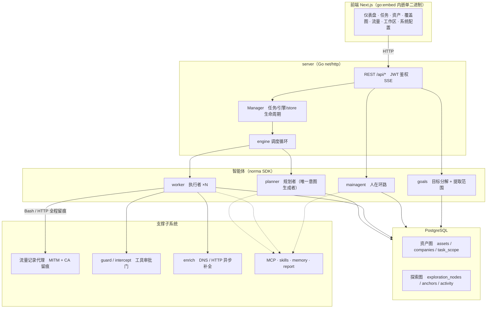
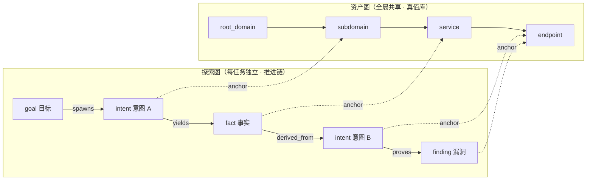
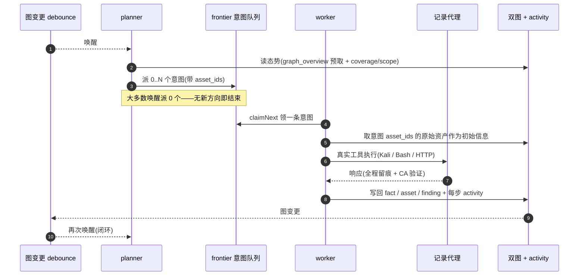
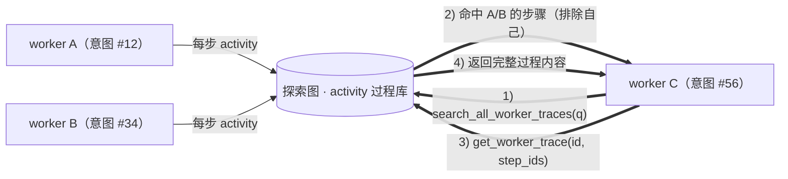
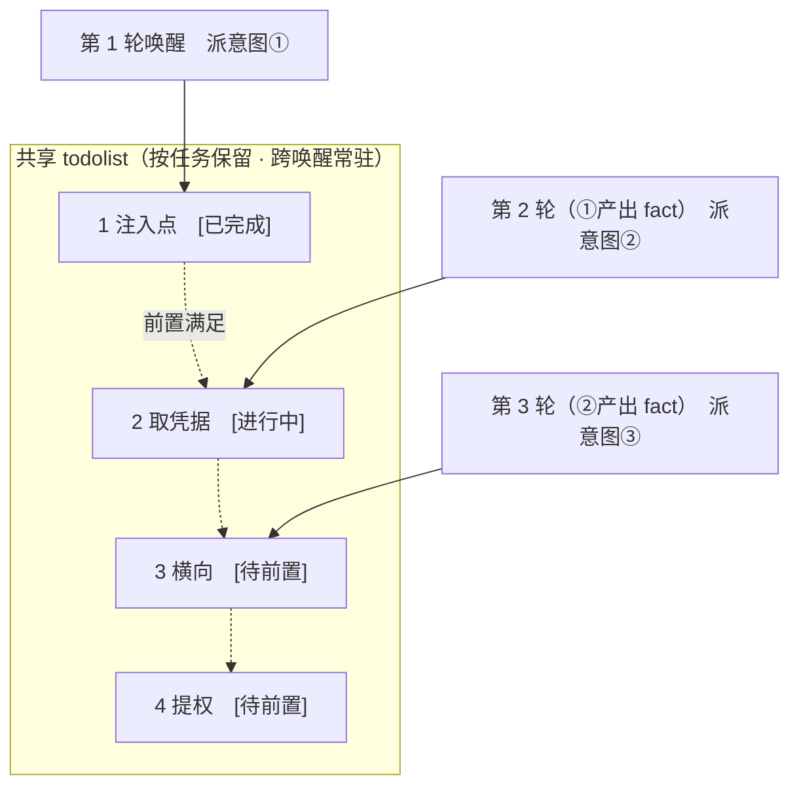

<div align="center">

# ARTEX — 全球版

**由 LLM 多智能体驱动的自主渗透测试系统**（Go 后端 + Next.js 前端）

界面与生成的输出默认使用简体中文，**可以在设置（系统 → 设置 → 显示语言）中切换为英语、韩语、西班牙语或日语。** 切换语言时，智能体生成的报告、摘要与对话回复的语言也会一起改变。

中文 · [English](README.en.md) · [한국어](README.ko.md) · [Español](README.es.md) · [日本語](README.ja.md)

[](https://github.com/jiwoochris/artex-global/actions/workflows/ci.yml) [](https://github.com/jiwoochris/artex-global/actions/workflows/detections.yml) [](https://github.com/jiwoochris/artex-global/actions/workflows/web.yml) [](LICENSE)

🌐 **在线 Demo**： [https://artex-demo.vercel.app/](https://artex-demo.vercel.app/)

</div>

---

> ## 🚨 安全与误用警告 — 请先读这一段
>
> **本仓库只面向已获授权的使用环境公开，且只用于建设防御与检测能力。**
>
> ARTEX 是一件足够强大的自主进攻工具：几乎不需要人工介入，就能把一次攻击从侦察推进到入侵、再到数据外带，因此误用造成的危害同样巨大。2026 年 10 月，韩国多家媒体报道，调查机构在针对韩国金融机构的个人信息泄露事件中发现了上游 ARTEX 被使用的迹象，相关调查仍在进行中。公开这个全球版不是为了帮助攻击者，而是帮助防守方理解这类自主 AI 攻击如何运作，并建立检测和拦截它们的能力。
>
> - **未经授权的使用本身就构成犯罪。** 不要对你不拥有、或没有明确书面授权的系统执行任何扫描、探测或利用。在大韩民国，未经授权侵入信息通信网络违反《信息通信网法》，涉及个人信息时《个人信息保护法》同样适用。
> - **不要以线上服务或他人的资产为目标。** 只在你自己拥有的学习、研究与本地隔离环境（例如 OWASP Juice Shop、DVWA 这类故意做成脆弱的目标）中验证。
> - **请从防守方的视角阅读。** 本仓库同时整理了针对自主 AI 攻击的防御与检测资料，例如检测签名与加固清单。→ **[防御与检测指南](docs/defense-zh.md)**（英文版 [docs/defense-en.md](docs/defense-en.md)、韩语版 [docs/defense-ko.md](docs/defense-ko.md)）
>
> 如果你不同意本警告以及下文的[使用限制与免责声明](#许可与免责声明)，请不要下载或使用本仓库。

---

> **本仓库是中国开源项目 [Autumn-27/ARTEX](https://github.com/Autumn-27/ARTEX)（AGPL-3.0 · 上游仓库当前无法访问，2026-10 核查）的多语言本地化版本 [jiwoochris/artex-global](https://github.com/jiwoochris/artex-global) 的简体中文发行版 fork（[YangZiyueZY/artex-ko](https://github.com/YangZiyueZY/artex-ko)），目标是让中文用户和团队能够直接采用。** 为保持智能体的决策性能，内部推理提示词保留原语言，只把面向用户的输出（漏洞发现、摘要、报告、对话回复）强制为所选语言（默认简体中文）。理由见下文[「为什么要做全球版」](#为什么要做全球版)。

ARTEX 是一套由多个 LLM 驱动的智能体自主执行渗透测试的系统：它们**自己拆解目标、执行真实工具，并在过程中把发现的资产与漏洞累积成图**。一个 Go 单二进制内嵌了 Next.js 前端，所有数据存放在 PostgreSQL 中。

> **关于本版本的语言。** 本 fork 让产品在五种语言下可用——**简体中文（默认）、英语、韩语、西班牙语、日语**——可在设置中选择。面向用户的输出会被强制为所选语言，而智能体的内部推理提示词保持原语言，以保住已基准测试过的性能。输出语言是如何由一段写死在代码里的指令强制的，见[配置](#配置)。

---

## 请先阅读：授权用途与国内法提示

ARTEX **只能用于你自己拥有的、或已获得明确书面授权的目标。** 任何超出授权范围的扫描、探测或利用，本身就可能违法。

- 在大韩民国，未经授权侵入或干扰他人的信息通信网络，违反**《信息通信网利用促进及信息保护等相关法律》**（Network Act）。
- 渗透测试过程中收集或暴露的个人信息，受韩国**《个人信息保护法》**（Personal Information Protection Act）约束。即便有授权，也要谨慎处理个人信息的查阅、留存与删除。
- 无论你在哪里使用，都要遵守当地关于网络安全、数据保护与计算机犯罪的法律。
- 请用于**学习、研究以及本地隔离环境中的验证。** 在以任何线上外部系统为目标之前，先取得书面授权，并约定范围与时间窗口。

完整的许可条款、使用限制与免责声明见下文[许可与免责声明](#许可与免责声明)一节。使用本工具即表示你同意这些条款。

---

## 为什么要做全球版

上游 ARTEX 的提示词、界面与文档全部是中文，对不读中文的人来说，阅读结果并与团队共享都很麻烦。本版本的目标是：

- **输出本地化** — 智能体呈现给人的漏洞发现、事实摘要、最终报告与对话回复，都会被强制为所选语言（默认简体中文；可切换英语、韩语、西班牙语、日语）。命令、payload、代码、URL 与原始日志是分析所需的，保持原样。
- **保住性能** — 驱动智能体判断的内部推理提示词（行为指令正文）**不做翻译**。保持以原语言基准测试过的行为不变，只改变输出语言，避免翻译带来的质量漂移。
- **讲清法律边界** — 明确写出「仅限授权范围」的警告，并附上维护者所在国（韩国）关于网络与隐私法律的提示；你在哪里运营，就同时适用哪里的法律。
- **支持多样的 LLM 栈** — LLM 供应商可以从前沿模型换成任意 OpenAI 兼容端点（本土或开源模型）。见[配置](#配置)。

> 这个多语言版本的边界与设计方针在仓库的工作笔记里有更详细的记录。为了便于与上游仓库对照 diff，上游的中文 README 内容已并入本简体中文主文档——本文件 `README.md` 就是中文主文档，原 `README.zh.md` 保留为一句指向本文件的说明。

---

## 截图预览

> 完整交互见[在线 Demo](https://artex-demo.vercel.app/)。

> 下面几张是**上游原版（中文界面）**的截图，随上游一起原样保留，便于与上游 1:1 对照；英语界面的交付截图见下一小节。

| 仪表盘（总览 / Token 消耗 / 活动流） | 任务列表 |
| :---: | :---: |
|  |  |

| 任务 · 执行过程（会话 / 工具调用） | 探索链路 |
| :---: | :---: |
|  |  |

| 发现 | 资产 |
| :---: | :---: |
|  |  |

| 资产覆盖图（力导向布局 · 已测高亮 · 节点折叠展开） |
| :---: |
|  |

| 流量录制 | 人在环路对话 |
| :---: | :---: |
|  |  |

| 智能体管理 | LLM 配置 |
| :---: | :---: |
|  |  |

| 拦截审批 | 后端日志 |
| :---: | :---: |
|  |  |

### 英语界面

下面三张是**英语界面**下的交付截图（界面语言可在设置中切换为简体中文、韩语、西班牙语、日语）。数据来自本地隔离沙箱：所有目标都是虚构的 `acme.com` 与私网地址段。

<p align="center">
  <br>
  <sub><b>仪表盘</b> — 活跃任务、确认发现、资产节点、LLM token 消耗与活动流同屏呈现。</sub>
</p>

<p align="center">
  <br>
  <sub><b>发现</b> — 按严重程度、状态、资产与所属任务聚合的漏洞结果，可导出 CSV。</sub><br>
  <sub>漏洞<b>标题</b>由模型生成，因此会出现英文技术词，与目标应用保持一致（[模型选择与输出语言](#模型选择与输出语言)）。每个标题之下的描述与其余界面文本为英语（截图所用显示语言，可在设置中切换）。</sub>
</p>

<p align="center">
  <br>
  <sub><b>对话</b> — 人类介入自主运行过程注入提示，智能体同时以英语总结攻击链。</sub>
</p>

---

## 审批记录详情

全局「审批记录」、任务内「拦截审批」及对话中的审批卡片均支持展开查看详情。展示结构参考
[AegisHook 的审批详情组件](https://github.com/RuoJi6/AegisHook/blob/main/web/src/components/CallDetail.vue)，沿用 ARTEX 的组件和主题：


---

## 资产同步（ScopeSentry）

支持从 [ScopeSentry](https://github.com/Autumn-27/ScopeSentry) 直接同步资产数据，免去重复收集：

- 在「**资产同步**」页填 ScopeSentry 的地址与 API Key，接入数据源；
- 按**项目**或**任务**维度选择要同步的目标与资产类型（域名 / 子域 / IP / 端口 / 站点 / 端点…）；
- 一键导入并按公司资产范围归并，直接进入 ARTEX 的资产图供智能体探索使用。

---

## 快速开始（Docker Compose）

> **前置条件：** Docker 与 Docker Compose。数据库是 **PostgreSQL**，由 compose 一起拉起。探索需要配置 **LLM**（`ANTHROPIC_API_KEY` 或 `OPENAI_API_KEY`，也可在 UI 里配）。

> **镜像：** `docker-compose.yml` 里的 `artex` 服务拉取 `ghcr.io/jiwoochris/artex-global`，即本仓库每次打发布标签（`v*`）时发布到 GitHub Container Registry 的全球版镜像。默认标签是 `latest`（最近的发布）；在 `.env` 里设 `ARTEX_TAG` 可固定到某个版本。上游原镜像 `autumn27/artex` 已从 Docker Hub 下架，不再使用。

```bash
git clone https://github.com/YangZiyueZY/artex-ko.git
cd artex-ko
cp .env.example .env          # 填 POSTGRES_PASSWORD；ANTHROPIC_API_KEY 可选
docker compose up -d          # 一起拉起 artex 镜像 + postgres
# → 打开 http://localhost:8787（首次进入 /setup 设置管理员密码）
#   /setup 需要输入启动日志里打印的设置令牌：docker compose logs artex | grep -F '[auth]'
```

镜像已内置常用工具（ripgrep、curl、vim、npm、nmap 等）；用 compose 拉起时，`./skills` 与 `./data` 以绑定挂载持久化，容器重建后仍然保留。

---

## 安装

> 依赖数据库 **PostgreSQL**；探索需配置 **LLM**（`ANTHROPIC_API_KEY` 或 `OPENAI_API_KEY`，也可在 UI 里配）。

上游提供了多种安装方式：一键安装脚本（`./install.sh`）、Docker Compose、预编译二进制（Releases）以及从源码编译单二进制；本全球版沿用同一套脚本与可执行文件。

### 方式一：一键安装脚本（推荐）

```bash
git clone https://github.com/YangZiyueZY/artex-ko.git
cd artex-ko
./install.sh
```

脚本会：检测 / 自动安装 Docker → 让你选 **① 全部 Docker** 或 **② 本地编译运行**：

- **① 全部 Docker**：填一个 Postgres 密码（可回车随机）→ 自动写 `.env` → `docker compose up -d`（拉取并启动与上文「快速开始」相同的镜像 `ghcr.io/jiwoochris/artex-global`）。
- **② 本地运行**：选数据库（连已有 / 用 Docker 起一个）→ 生成 `config.json` → `go` 编译内嵌单二进制 → 启动（与下文**方式四**相同）。

装好后打开 **http://localhost:8787**（首次进入 `/setup` 设置管理员密码；`/setup` 需要输入启动日志中打印的设置令牌，见下文「首次运行保护」）。

### 方式二：Docker Compose（手动）

```bash
git clone https://github.com/YangZiyueZY/artex-ko.git
cd artex-ko
cp .env.example .env          # 填 POSTGRES_PASSWORD、可选 ANTHROPIC_API_KEY
docker compose up -d          # 拉取 ghcr.io/jiwoochris/artex-global 镜像 + postgres
# → http://localhost:8787
```

镜像已含常用工具（ripgrep/curl/vim/npm/nmap…）；`./skills` 与 `./data` 以绑定挂载持久化。

远程 MCP 可在系统设置中选择 `http`（Streamable HTTP）或 `sse`（旧版 SSE）。
旧版 SSE 服务通常使用 `GET /sse` 建立事件流，再通过服务返回的
`/message?sessionId=...` 接收 JSON-RPC 请求；配置时将 URL 填为 `/sse`，请求头按
`Authorization=Bearer <token>` 填写。

### 方式三：下载预编译二进制（Releases）

到 [Releases](https://github.com/Autumn-27/ARTEX/releases) 下载对应平台的 zip，解压后得到 `artex` + `start.sh`（Windows 为 `start.bat`）+ `skills/` + `config.example.json`：

```bash
cp config.example.json config.json   # 填好 database 连接
./start.sh                           # → http://localhost:8787
```

> 上游仓库当前无法访问（2026-10 核查）；本全球版的发布镜像随 `v*` 标签发布到 GitHub Container Registry，见上文「快速开始」。

> 请用 `start.sh` / `start.bat` 启动，而不是直接跑 `./artex`。它是个守护脚本：程序退出后按退出码决定是否重新拉起，**页面上的[一键更新](#方式一页面一键更新推荐)靠它完成换装**。直接运行 `./artex` 时更新完就不会被拉起了。
> 后台常驻：`nohup ./start.sh >artex.log 2>&1 &`。

### 方式四：从源码编译单二进制

```bash
# 1) 前端静态导出
cd web && npm ci && npm run build:static && cd ..
# 2) 拷进内嵌目录（先清空，避免重复构建时在 dist 下再套一层 web）
rm -rf server/webui/dist && mkdir -p server/webui/dist && cp -a web/out/. server/webui/dist/
# 3) 编译（-tags embedui 才内嵌前端）
CGO_ENABLED=0 go build -tags embedui -o artex ./cmd/artex
./start.sh                                          # → http://localhost:8787
```

> 第 1) 步的 `npm ci` 要安装构建所需的 devDependencies（例如 `@tailwindcss/postcss`）。如果你的 shell 里设了 `NODE_ENV=production`，`npm ci` 会跳过 devDependencies，构建会以 `Error: Cannot find module '@tailwindcss/postcss'` 失败；这时改用 `npm ci --include=dev`。

### 方式五：构建跨平台 Release 压缩包

`build.sh` 会先构建并嵌入前端，再使用 Go linker 去除调试信息，并将发布文件压缩为 zip。Release 模式默认生成 Linux amd64/arm64、macOS amd64/arm64 和 Windows amd64 的 zip 包：

```bash
./build.sh --release
# 产物：dist/artex-0.3.3-*.zip
```

UPX 自解压二进制可能与部分 Linux 内核、虚拟化环境或安全策略不兼容，因此默认不启用。可用 `ARTEX_TARGETS` 自定义目标；确认目标运行环境兼容时，可显式传入 `--upx` 进一步缩小二进制：

```bash
ARTEX_TARGETS=linux/amd64,windows/amd64 ./build.sh --release
./build.sh --target linux/amd64 --upx
```

---

## 更新升级

> 升级只换程序、不动数据：Postgres 数据卷 `pgdata`、`./data`（jwt.key / SQLite 等）、`./skills` 都会保留。**数据库迁移无需手动执行**——`artex` 每次启动会幂等重跑 `schema.sql`（含 `ADD COLUMN` / `CREATE INDEX IF NOT EXISTS`），即“重启即迁移”。升级前仍建议先备份 `./data` 与数据库。

### 方式一：页面一键更新（推荐）

在 **系统配置** 页（侧边栏「系统配置」→ `/system/settings`）的**版本与更新**卡片里，可以直接检查并安装新版本，无需登录服务器。

点「更新」后：下载当前平台的发布包 → 比对 Release 的 `SHA256SUMS` → 用 `-h` 冒烟测试新二进制 → 暂存为 `artex.new` → 程序退出，由 `start.sh` / `start.bat` 重新拉起并完成换装。页面会自动等到新版本上线后刷新。

- **失败不会留下坏程序**：校验或冒烟不通过就丢弃暂存件、继续跑当前版本；换装后的新版若连续 3 次启动失败，会自动回滚到 `artex.old`（失败的那个留作 `artex.failed` 供排查）。
- **随时可回退**：上一版本保留为 `artex.old`，卡片上有「回滚到上一版本」。注意数据库结构不会回退。
- **更新会中断正在运行的任务**——更新即重启，请在空闲时进行。
- **开发构建不给更新**：版本号是 `dev` 或 `git describe` 带后缀时禁用，避免正式版覆盖掉本地调试的二进制。
- **Docker 下只换程序、不换镜像**：镜像里的 playwright / nmap 等工具链不会跟着升级，且 `docker compose up -d` 重建容器后会退回镜像自带的版本。要连镜像一起升级仍请用 `docker compose pull artex && docker compose up -d artex`。
- 访问 GitHub 需要代理时，在同一页面配置**全局代理**即可，更新链路会走它。更新只从 GitHub 域名下载并强制 HTTPS。

### 方式二：一键更新脚本

```bash
cd artex-ko
./update.sh
```

脚本先可选 `git pull` 拉取最新代码，再让你选 **① Docker 更新** 或 **② 本地编译更新**（与 `install.sh` 对应）：

- **① Docker**：可指定目标镜像 tag（回车沿用 `.env` 的 `ARTEX_TAG`，缺省 `latest`）→ `docker compose pull` → `docker compose up -d`（换新镜像重启即自动迁移）。
- **② 本地**：重建前端静态产物 → 重新编译 `./artex`（完成后重启进程生效）。

### 方式三：Docker Compose（手动）

```bash
cd artex-ko
git pull                       # 更新 compose / 脚本（可选）
# 指定版本：在 .env 设 ARTEX_TAG=v0.2.0；不设则用 latest
docker compose pull artex
docker compose up -d artex     # 换新镜像重启 → 自动迁移 schema
docker image prune -f          # 清理旧镜像（可选）
```

### 方式四：预编译二进制（Releases）

到 [Releases](https://github.com/Autumn-27/ARTEX/releases) 下载新版本 zip，停掉旧进程后覆盖 `artex` 与 `skills/`（保留你的 `config.json` 与 `data/`），重启即可：

```bash
cp -r <解压目录>/skills ./ && cp <解压目录>/artex ./
./start.sh
```

### 方式五：从源码编译

```bash
git pull
cd web && npm ci && npm run build:static && cd ..
cp -r web/out server/webui/dist
CGO_ENABLED=0 go build -tags embedui -o artex ./cmd/artex
# 重启 ./start.sh
```

---

## 配置

**数据库**（`config.json`，或用环境变量 `ARTEX_PG_DSN` 覆盖）：

```json
{
  "database": {
    "host": "127.0.0.1", "port": 5432,
    "user": "artex", "password": "yourpass",
    "dbname": "artex", "sslmode": "disable"
  }
}
```

**LLM**：`export ANTHROPIC_API_KEY=sk-...`（或 `OPENAI_API_KEY`），也可在 UI 的「LLM 配置」页填写。可选环境变量：`ARTEX_LLM_PROVIDER` / `ARTEX_LLM_MODEL` / `ARTEX_LLM_BASE_URL` / `ARTEX_LLM_PROXY`。要用本土或开源模型，把 `ARTEX_LLM_BASE_URL` 指向 OpenAI 兼容端点即可。

**输出语言**：本版本通过在每个角色的 system prompt 末尾追加一段写死在代码里的指令（`agent/prompt.go` 的 `langDirective`），把面向用户的输出强制为所选语言（默认简体中文），它不翻译推理正文。在设置中切换语言，或按需改写 `langDirective`。

**并发**：每个任务的 worker 智能体数量在「系统设置」里配置（默认 3）。

**常用参数**：`./start.sh -addr :8787 -proxy :8788`（`-addr` 前端 + API，`-proxy` 流量录制代理）。启动脚本会把参数原样透传给 `artex`。本版本中 `-addr` 默认值为 `127.0.0.1:8787`（仅本机），需要从其他机器访问时请显式指定如 `:8787`（见下文「首次运行保护」）。

### 模型选择与输出语言

输出语言的强制**由提示词指令（`agent/prompt.go` 的 `langDirective()`）驱动，并没有写死的上限**。因此输出能多稳定地保持在所选语言，取决于模型能力、角色与上下文。下面的验证数据是在韩语为默认语言时用韩语输出测得的；其他语言趋势相同。

- **使用能力足够的前沿模型。** 在只应用生产指令、针对本地隔离沙箱的短验证中，默认模型 `claude-opus-4-8` 在四个角色（planner、worker、reporter 以及一次授权沙箱的规划请求）上都把面向用户的输出保持在韩语，且没有拒答；`gpt-4o` 在同样的场景下也保持在韩语。相反，更便宜的小模型（例如 `gpt-4o-mini`）会让报告退回原语言。输出语言质量与模型能力直接相关，凡是有人要读报告的场景，都应使用能力足够的模型。
- **仍会残留一些与角色、上下文相关的漂移。** 偏差更多表现在角色与输出格式上，而不是语言本身。尤其是 worker 最后一句总结这类短输出，可能原样带出模型的英语思维链；`report_finding` 的结构化字段也可能偏向英语，与目标应用及其技术术语保持一致。在更早的一次运行中，`gpt-4o` 的 planner 态势摘要也有若干轮退回原语言。在任务指令里显式写明「用所选语言书写」，可以提高保真度。
- **给推理模型留足 `max_tokens`。** 使用独立思考通道的推理模型，可能把很小的回复 token 预算全部花在内部推理上，导致面向用户的最终答案为空。这时消失的是答案而不是语言，因此要把该 LLM 配置的 `max_tokens` 设得足够大。

> **OpenAI 兼容路径上的 token 上限陷阱。** `gpt-4o` 这类 OpenAI 系模型把回复 token 上限设为 16,384；而 OpenAI 兼容请求的默认输出上限更大（32,768），沿用默认值会让每次调用都以 `400 (max_tokens is too large)` 失败。这种情况下，**在「LLM 配置」页把该配置的 `max_tokens` 设为 16,384 或更小。** Anthropic 系模型（包括默认的 `claude-opus-4-8`）允许 32,768，不会踩到这个坑。

### 首次运行保护（设置令牌与绑定地址，本分支新增）

只有一个管理员账号（`ARTEX`），密码在首次访问 `/setup` 时创建。为了让先访问到一个尚未初始化的实例的人不能把它占为己有，有以下保护措施。

- **设置令牌**：尚未设置密码时，启动日志会打印一行 `[auth] … Setup token: …`（Docker 用 `docker compose logs artex` 查看）。`/setup` 与 `POST /api/auth/init`（`setup_token` 字段）必须带上该值才能创建密码，错误尝试会被限速。无人值守部署可用 `ARTEX_SETUP_TOKEN` 固定令牌，或用 `ARTEX_ADMIN_PASSWORD` 直接设置密码（至少 8 位）。
- **默认只绑定 127.0.0.1**：`-addr` 默认值与 `docker-compose.yml` 的端口发布都只开在本机回环地址。需要从其他机器访问时改为 `-addr :8787` 或在 `.env` 中设置 `ARTEX_BIND=0.0.0.0`，但请先完成初始设置，并优先使用下方的反向代理方案；在非回环地址上、尚未设置密码就启动时，日志会打印一条警告。
- **修改密码会使所有旧会话失效**：令牌签名密钥与密码哈希绑定，无论通过界面、`reset-password.sh` 还是直接改库，旧令牌都会在几秒内失效。若是在账号被入侵后做恢复，改密码之后还应检查自定义工具、MCP、LLM 与通知设置。
- **CORS**：`/api` 仅允许 `ARTEX_CORS_ORIGINS`（逗号分隔）中列出的来源跨域调用；内置 UI 同源，通常留空，默认只放行 `dev.sh` 起的 `next dev`（`http://localhost:5173`）。

### 反向代理部署（HTTPS / 只开放 443）

前端和 API/SSE 都由同一个后端端口（默认 `:8787`）提供，实时活动流默认走**同源**地址，因此**无需配置 `NEXT_PUBLIC_SSE_BASE`**，公网只开放 443、把 8787 留在内网即可。

SSE 是长连接 + 持续推送，反代**必须关闭缓冲**，否则浏览器能连上却收不到事件（表现为活动流一直转圈）。Nginx 示例：

```nginx
server {
    listen 443 ssl;
    server_name your.domain.com;
    # ssl_certificate / ssl_certificate_key ...

    location / {
        proxy_pass http://127.0.0.1:8787;
        proxy_set_header Host $host;
        proxy_set_header X-Forwarded-Proto $scheme;

        # SSE 关键项：关缓冲、长超时、HTTP/1.1
        proxy_buffering off;
        proxy_cache off;
        proxy_read_timeout 3600s;
        proxy_http_version 1.1;
        proxy_set_header Connection "";
    }
}
```

> 仅当 SSE 需要走与页面不同的来源（如独立子域）时，才在**构建期**设置 `NEXT_PUBLIC_SSE_BASE`（该变量在 `next build` 时固化进静态包，容器运行时再设无效）。

---

## 系统技术架构

ARTEX 是一套 **LLM 多智能体驱动的自主渗透系统**：Go 单体后端（内嵌 Next.js 前端）+ PostgreSQL，智能体能力由 [`norma`](https://github.com/Autumn-27/norma) SDK 提供（`agentcore` / `tool` / `permission` / `harness` / `memory` / `transcript`）。核心是**双图架构**，以及围绕它的两条自主性机制：**worker 间过程级信息交换**与 **planner 多轮共享 todolist 稳定攻击链路**。

### 总体分层



| 层 | 职责 |
| --- | --- |
| **前端** | Next.js 静态导出，`go:embed` 内嵌进单二进制；可视化任务/资产/探索链路/覆盖图，人在环路对话 |
| **server** | `net/http` 路由 + JWT 鉴权 + SSE；`Manager` 托管任务、引擎、DB store 的生命周期 |
| **engine** | 每任务一个 `plannerLoop` + N 个 worker goroutine；意图领取、超时/暂停/drain |
| **agent** | goals / planner / worker / mainagent，`ToolSet` 把双图暴露成 LLM 工具 |
| **db** | 双图的 Postgres 落地（pgx）；schema 随 `go:embed` 每次启动幂等建表 |
| **支撑** | 记录型 MITM 代理、审批门、异步补全、MCP/技能/记忆/报告 |

### 双图架构：探索图 + 资产图

系统把「**目标是什么**」和「**测到了什么程度**」拆成两张相互独立、又通过锚点相连的图：

- **资产图（Asset Graph，全局共享）**：跨任务同一份的资产真值库。节点为 `root_domain / subdomain / ip / service / app / endpoint`，归属公司；域名→子域→服务→端点的父子关系与去重 key 全部由程序计算，智能体只提交原始信息。
- **探索图（Exploration Graph，每任务独立）**：一次任务的“思考与推进”过程。节点为 `goal（目标）/ intent（意图）/ fact（事实）/ finding（漏洞）/ hint（提示）`，靠 `spawns / derived_from / yields / proves` 等边连成**血缘链**，回答“哪个方向派生自哪些事实、产出了什么”。
- **两图靠锚点相连**：`exploration_anchors(node_id, asset_id)` 把意图/事实/漏洞锚定到具体资产上——于是既能从“探索方向”看它打的是哪些资产，也能从“某个资产”反查它在本任务被哪些意图测过、得出过哪些事实。这也支撑了**资产测试覆盖度**与**资产覆盖图**（范围内资产 + 已测高亮）。



> 分工：**planner** 读探索图态势、判目标、只在有未覆盖的新方向时派**意图**进 frontier；**worker** 领**一条意图**、用真实工具执行、把新资产/事实/漏洞写回两图后即停。资产图是共享事实，探索图是每任务的推进链。

### 引擎与意图生命周期（一次探索的闭环）

引擎是**事件驱动**的闭环：图一变就唤醒 planner，planner 派意图，worker 领意图执行并写回，写回又触发下一轮——直到目标被证明（`prove_goal`）。



### worker 间的过程级信息交换

一次深入的探索里，很多有价值的观察（某个报错、某段响应、某个隐藏参数）出现在一个 worker 的**执行过程**中，却未必被写成正式 fact。为避免重复劳动、让链路上的 worker 能站在彼此的肩膀上，worker 具备**跨 work 检索过程**的能力：

- `search_all_worker_traces(q)`：在**本任务其他 work 的执行过程**里按关键字检索（自动排除自己这条意图的步骤），命中项带 `intent_id`；
- `list_worker_traces` / `get_worker_trace(intent_id, step_ids=[…])`：先看有哪些 work 跑过，再取某个 work 具体几步的完整内容做细节交换。

这样即便探索图上还没有对应的 fact，后续 worker 也能复用他人过程中的观察——**信息在 worker 之间以“执行过程”为粒度流动**，而边界不变（每个 worker 仍只做自己领到的那条意图）。



### planner 多轮共享 todolist → 稳定的攻击链路

真实攻击链往往是**有前后依赖的多步序列**（如：发现注入点 → 拿到凭据 → 横向 → 提权），一次性把这些并行派下去只会乱套。planner 因此持有一份**按任务保留、跨唤醒共享的规划待办（todolist）**：

- planner 是事件驱动的——图一变就被唤醒，但**每次唤醒是全新会话**；共享的 todolist 让它把一条串行利用链**记录一次**、然后在后续多轮里**按依赖逐步派意图**，而不是把整条链在一轮里全部前置展开；
- 每轮只对「前置步骤已完成、其依赖的 fact 已存在」的下一步派意图，并随进展更新清单（把已被 fact 满足的步骤标完成）。



于是攻击链在“事件驱动 + 无状态会话”的环境下依然**稳定推进、不重复、不错序**——这是 ARTEX 能自主走完多步利用链的关键。

---

## 防御与检测资料

本仓库的目标是帮助**防守方**理解自主 AI 攻击如何运作，并建立检测与拦截它的能力。它把上文架构中看到的 ARTEX 行为反过来摆成**防守方视角**，说清该观察什么、该在哪里收紧。

- **[防御与检测指南（docs/defense-zh.md）](docs/defense-zh.md)**（英文版 [docs/defense-en.md](docs/defense-en.md)、韩语版 [docs/defense-ko.md](docs/defense-ko.md)）
  - 自主 AI 攻击与传统扫描器的差别、为什么难以检测，以及仍然可以怎样检测
  - 防守方可以观察的指纹（IoCs 与行为签名）——分为目标视角与取证视角
  - 攻击者会针对的入口点与对应的加固（辅助认证、IDOR、撞库、会话与密钥）
  - WAF/SIEM/认证日志的检测规则（伪规则）、加固清单，以及事件响应要点
  - 韩国官方的情报泄露指标与公告渠道（KISA、FSI、PIPC）以及韩国法律规定的报告义务
- **[可直接部署的检测规则（detections/）](detections/)** — 把指南里的指纹检测做成开箱即用的规则：主机/日志/SIEM 层是 [Sigma](https://sigmahq.io) 规则（原子 + 关联；用 `sigma convert` 转换到 Splunk、Elasticsearch 等），网络层是 [Suricata](https://suricata.io) 规则，针对 enrich 探测器与 norma SDK 的 WebFetch User-Agent。
  - **[ATT&CK 覆盖层（detections/attack/）](detections/attack/)**：一份 [MITRE ATT&CK Navigator](https://mitre-attack.github.io/attack-navigator/) 图层（JSON），把上面的规则映射到它们标记的技战术，一眼就能看出每条规则覆盖了哪种攻击行为。每个技战术只来自规则的 `attack.*` 标签，没有靠猜测补进去的东西。
  - **[机器可读的指标清单（detections/indicators/）](detections/indicators/)**：ARTEX 自身会发出的独有指纹，汇总成一个 CSV（`artex_indicators.csv`），同时以可直接导入的 MISP 事件（`artex_indicators.misp.json`）提供，可以直接丢进 SIEM 查找表或威胁情报平台（MISP，或任何能吃 MISP 格式的东西）当作失陷指标（IoCs）。每个值都是在仓库源码中核实过的字符串，每行都带来源文件与检测规则。
  - **[主机分诊脚本（detections/triage/）](detections/triage/)**：一个只读脚本 [`artex_host_triage.py`](detections/triage/artex_host_triage.py)，给那位站在单台可疑主机 shell 前、既没有 SIEM 也没有网络传感器的响应人员用。它检查的指纹与上面的规则一致，另外还在本机检查三项指标 CSV 有意不配 Sigma 规则的主机/数据库指标（因为它们在日志与网络上观察不到：服务监听端口、录制代理端点、PostgreSQL 探索 schema）。它只用标准库，无需安装任何东西；每条发现都只是一个分诊线索，结论与其指标行一样带有保留条件，绝不单独构成归因。
  - 上面的规则、图层、指标以及主机分诊脚本的自测，都由仓库测试（[detections/tests/](detections/tests/)）重新跑过并验证：一条跑不起来的检测规则只是一个声明。

> 这些资料会持续扩充。有补充的检测规则或加固项，请以 issue 提出；直接提交规则时，请遵循[贡献指南（中文）](CONTRIBUTING.md)中「检测规则与检测测试的贡献」一节的契约（每条指标都要落在可观察的事实上、写明局限、通过静态校验、附带可复现的测试），英文原文见[对应章节](CONTRIBUTING.en.md#contributing-detection-rules-and-detection-tests)。

---

## 开发

### 手动漏洞复测

任务详情的「复测」页签可分页选择本任务的漏洞、查看历次结论和证据，并手动发起复测。启动后保留当前页签，显示转圈图标和「复测中」；确认修复后同步更新漏洞状态。

在漏洞列表每行操作区点击「复测」，或在漏洞详情的「漏洞复测」区域点击「发起复测」，填写可选的修复版本、测试条件或限制，系统会创建独立的复测智能体会话，启动后保留当前页面。列表的平铺、按任务分组和资产视图均支持该入口；复测运行时显示转圈图标和「复测中」，需要查看时点击进入对应会话，结束后恢复「复测」。复测无需重新启动原扫描任务，结论分为「仍可复现」「已修复」「无法确认」，每次的结论、证据和会话链接保存在漏洞详情中。

新版后端首次启动会预置可编辑的「漏洞复测」（`retester`）智能体，可在智能体管理中配置提示词、LLM、运行预算和工具。默认使用其绑定的 LLM，未绑定则使用全局激活配置。复测会话成功完成且结论为「已修复」时，系统自动将漏洞处置状态改为「已修复」；执行中、失败、停止或其他结论保留原状态。原始证据和报告始终保留。也可在状态下拉菜单中手动选择「已修复」。同一漏洞正在复测时复用已有会话，停止、失败或服务重启后可重新发起。

本版历史记录通过漏洞详情和会话查看，暂未纳入漏洞报告导出或任务归档包，也未自动关联流量包。演示模式只生成明确标注的模拟记录，不请求真实目标。

### 本地运行与测试

```bash
./dev.sh    # 后端(:8787) + 流量代理(:8788) + 前端 next dev(:5173) → http://localhost:5173
```

- 后端：`go run ./cmd/artex`（不带 `-tags embedui` 则不内嵌前端）
- 前端：`cd web && npm run dev`（`/api` 反代到后端，带热更新）
- 测试：`go test ./...`
- Mock 预览（无后端）：`cd web && NEXT_PUBLIC_MOCK=1 npm run dev`

这个全球版相对上游 ARTEX 的改动，记录在[变更日志（CHANGELOG.md）](CHANGELOG.md)（英文版 [CHANGELOG.en.md](CHANGELOG.en.md)）。

---

## 贡献

欢迎提交 issue 与 pull request。

- 贡献流程、开发环境与检测规则贡献契约见[贡献指南（CONTRIBUTING.md）](CONTRIBUTING.md)（英文版 [CONTRIBUTING.en.md](CONTRIBUTING.en.md)）。
- 安全漏洞请按 [SECURITY.md](SECURITY.md) 说明的渠道报告（英文版 [SECURITY.en.md](SECURITY.en.md)）。
- 社区行为准则见 [CODE_OF_CONDUCT.md](CODE_OF_CONDUCT.md)（英文版 [CODE_OF_CONDUCT.en.md](CODE_OF_CONDUCT.en.md)）。
- 维护者的发布与支持流程见 [MAINTAINING.md](MAINTAINING.md)（英文版 [MAINTAINING.en.md](MAINTAINING.en.md)）。

---

## 交流群

扫码关注微信公众号 **SecSentry**，在公众号后台私信即可入群交流。

<div align="center">


</div>

---

## 参考

https://github.com/oritera/Cairn

---

## 许可与免责声明

### 开源协议

本项目采用 **GNU Affero General Public License v3.0（AGPL-3.0）** 授权，完整条款见仓库根目录的 [LICENSE](LICENSE) 文件。

这意味着任何人都可以自由使用、修改和分发本项目，但**衍生作品必须同样以 AGPL-3.0 开源**；特别地，**若你修改本项目并通过网络（如部署为在线服务）向用户提供，也必须向这些用户公开对应的完整源码**。本全球版同样保持 AGPL-3.0。

> ⚠️ **重要提示**：开源协议本身不限制软件的使用用途。以下的「使用限制」与「免责声明」是作者对使用者的额外约定与郑重声明，请务必遵守。

### 使用限制

- 使用本工具**阅读与研究源码**，并在**本地隔离环境**中**验证其技术原理**。
- 除非目标是你自己的、或你已获得**明确书面授权**，不要对任何网站、线上服务或联网系统进行扫描、探测、利用或攻击。
- 严禁用于非法入侵、数据窃取、拒绝服务（DoS）或任何其他破坏性、犯罪性活动。
- 你必须遵守所在国家/地区关于网络安全、数据保护与计算机犯罪的全部法律（在韩国为《信息通信网利用促进及信息保护等相关法律》《个人信息保护法》等）。

### 上游原作的严格限制（原样保留）

> **ARTEX 仅供个人学习、代码研究与本地技术验证使用，不得用于对任何线上系统或网站发起实际测试。**

- 仅可用于**阅读、学习与研究本项目源码**，以及在**本地隔离环境**中进行技术原理验证；
- 适用于个人学习、学术研究、代码审阅等非攻击性用途。

#### 禁止事项

- **严禁使用本工具对任何网站、线上服务或联网系统发起扫描、探测、利用或攻击**（无论是否获得授权、是否为自有资产）；
- 严禁将本工具用于任何实际的渗透测试、攻防对抗或生产环境；
- 严禁将本工具用于非法入侵、数据窃取、勒索、拒绝服务或任何破坏性、犯罪性活动；
- 严禁利用本工具从事违反所在国家/地区法律法规的行为。

### 合规责任

使用者须自行遵守所在国家/地区关于网络安全、数据保护与计算机犯罪的全部法律法规（在中国大陆包括但不限于《网络安全法》《数据安全法》《个人信息保护法》及相关司法解释）。**因使用本工具产生的一切法律责任与后果，均由使用者自行承担。**

### 免责声明

本项目按“现状（AS IS）”提供，不附带任何明示或默示的担保。作者及贡献者不对使用本工具（无论使用方式是否得当）所导致的任何直接或间接损失、数据丢失、系统损坏或法律纠纷承担责任。**下载、安装或使用本项目，即表示你已阅读、理解并同意上述全部条款。**

**一切法律责任与后果均由使用者承担。**

---

## 上游项目与致谢

- 上游仓库：[Autumn-27/ARTEX](https://github.com/Autumn-27/ARTEX)（目前无法访问，2026-10 核查）
- 上游原版 README（中文）：内容已并入本简体中文主文档 [README.md](README.md)；[README.zh.md](README.zh.md) 现在是一句指向本文件的说明
- 上游在线 Demo（中文界面）：[https://artex-demo.vercel.app/](https://artex-demo.vercel.app/)（目前无法访问，2026-10 核查）
- 智能体 SDK：[Autumn-27/norma](https://github.com/Autumn-27/norma)（目前无法访问，2026-10 核查）
- 本仓库（简体中文发行版 fork）：[YangZiyueZY/artex-ko](https://github.com/YangZiyueZY/artex-ko)
- 上游全球版 fork：[jiwoochris/artex-global](https://github.com/jiwoochris/artex-global)，维护者位于韩国；镜像发布在 GitHub Container Registry（`ghcr.io/jiwoochris/artex-global`）
- 资产同步：[Autumn-27/ScopeSentry](https://github.com/Autumn-27/ScopeSentry)
- 审批详情 UI 参考：[RuoJi6/AegisHook](https://github.com/RuoJi6/AegisHook)
